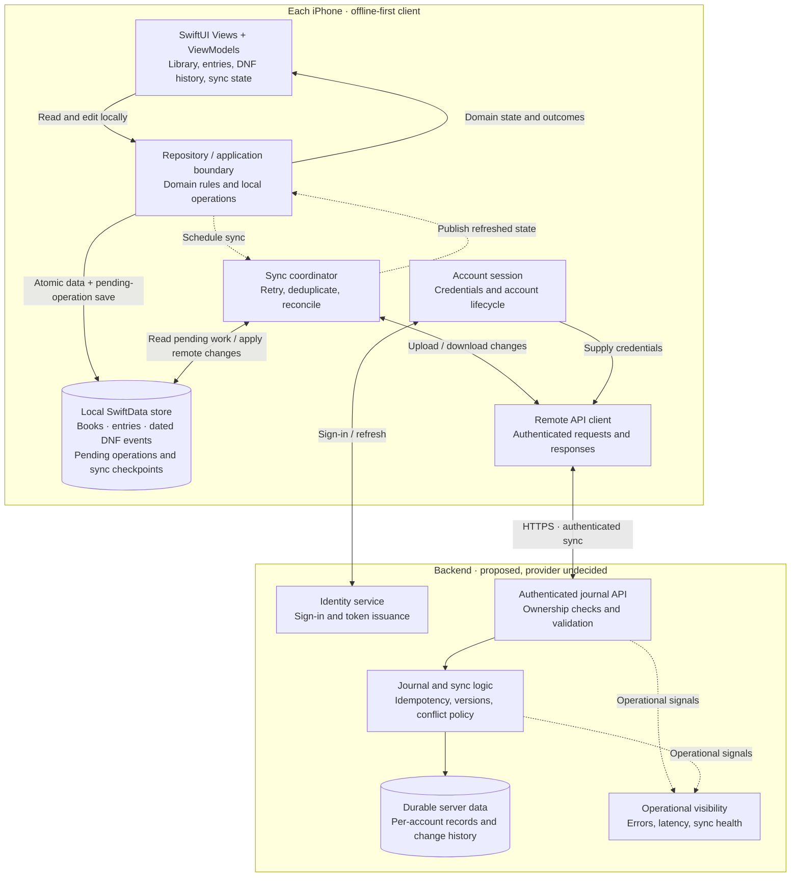

# Architecture

Audiobook Journal is a native iPhone app built with SwiftUI, MVVM, and SwiftData.
Its direction is an offline-first journal that can eventually synchronize across
devices without making everyday capture depend on a network.

- [Current architecture](#current-architecture): components that exist in code.
- [North Star](#north-star): a proposed target, not an implemented system.
- [Evolution and decisions](#evolution-and-decisions): how the two connect.

## Current architecture

**As of November 18, 2026.** Everything below runs on the device. There is no
account, remote API, or sync engine. This is a code-structure diagram;
[progress.md](progress.md) separately records runtime verification.

Solid arrows show calls or data access. Dotted arrows show construction,
configuration, or protocol conformance.

```mermaid
flowchart TB
    subgraph device["iPhone · current implementation"]
        app["AudiobookJournalApp<br/>Composition root"]
        subgraph presentation["Presentation · SwiftUI + MVVM"]
            views["ContentView · BookDetailView<br/>BookComposerView · EntryComposerView"]
            vm["LibraryViewModel · @MainActor<br/>State, validation, save outcomes"]
            contract["LibraryRepository protocol<br/>Fetch snapshot · save book · save entry"]
            views -->|"Actions / save callbacks"| vm
            vm -->|"Observed state / SaveResult"| views
            vm -->|"Domain Book and Entry values"| contract
        end
        subgraph persistence["Local persistence · @MainActor"]
            repo["SwiftDataLibraryRepository<br/>UUID lookup, insert or update"]
            mapping["StoredModelMapping<br/>Domain values ↔ stored records"]
            context["Private ModelContext<br/>Autosave off · save or rollback"]
            container["Shared ModelContainer<br/>Schema and store configuration"]
            disk[("On-device SwiftData store<br/>StoredBook · StoredEntry")]
            repo -->|"Convert records"| mapping
            repo -->|"Fetch / mutate / commit"| context
            context -->|"Read / write"| disk
            container -.->|"Creates and configures"| context
            container -.->|"Manages"| disk
        end
        app -.->|"Injects ViewModel into root View"| views
        app -.->|"Creates"| container
        contract -.->|"Implemented by"| repo
    end
```

### Responsibilities

| Boundary | Owns | Keeps outside |
| --- | --- | --- |
| Views | Drafts, presentation, alerts, navigation | Database queries |
| ViewModel | Validation, save coordination, observable domain state | SwiftData records and sheet dismissal |
| Repository protocol | Data operations the app needs | Concrete storage technology |
| SwiftData repository | Mapping, relationships, explicit saves and rollback | Form state and navigation |
| Composition root | Constructing and connecting dependencies | Screen behavior |

The ViewModel receives `any LibraryRepository`; the app injects the SwiftData
implementation. Tests can inject controlled implementations of the same contract.

The app also installs the container in SwiftUI's environment, which has its own
main context. The repository owns a separate private context from that same
container. Current Views observe the ViewModel rather than using `@Query`;
they do not depend on automatic observation across contexts.

### Read and write behavior

1. At launch, the ViewModel requests a `LibrarySnapshot`. The repository fetches
   records and maps them into domain values.
2. A View submits a draft or requests a status change. The ViewModel validates
   the request and prepares the proposed domain value.
3. The repository inserts or updates by UUID and explicitly saves. A save error
   rolls back pending context changes and is rethrown.
4. On success, displayed state updates. On failure, the View receives an
   explanation and retains its draft or previous status.

Repository methods are synchronous and main-actor isolated. This serializes
access; it does not move storage work into the background. Large operations can
still block the UI and would require a separate performance decision.

### Data and integrity

- Domain structs: `Book` and `Entry`. Stored records: `StoredBook` and
  `StoredEntry`. Views receive only domain values.
- One book has many entries. `Entry.bookId` maps to `StoredEntry.book`; a stored
  book deletion cascades to its entries. User-facing deletion is not implemented.
- UUIDs and creation timestamps survive mapping. Edits retain identity and
  update `updatedAt`.
- Entries are fetched oldest first by `createdAt`; the ViewModel also sorts the
  selected book's timeline by capture time, not chapter or modification time.
- Unknown stored enum values cause a load error. Saving an entry requires a
  matching stored parent book.
- Optional positive series/chapter numbers are enforced by composers and the
  ViewModel. Direct repository callers do not yet enforce those number rules.
- Series name and order are fields on `Book`; there is no separate Series model.
- DNF status and dated reasons are specified in [R-05](requirements.md#r-05-track-books-not-finished)
  but are not yet implemented in the schema.

## North Star

**Proposed target.** Preserve immediate local capture while adding optional
accounts and synchronization across devices. Boxes represent responsibilities,
not one deployed service each. AWS is a backend candidate; provider and service
selection remain open.

Solid arrows show calls or data access. Dotted arrows show asynchronous
coordination or change notifications. Journal data crosses the cloud boundary
through the remote API client.

### What remains true

Views continue to consume domain state. SwiftData remains the source for offline
use, and local capture does not require an account. Multiple devices run the
same client design, each with its own local store and synchronization state.

Local save success means a change is stored **on this device**, not that the
server has acknowledged it. Remote failure leaves pending work and a visible
sync state rather than erasing a successful local edit. This extends the current
`SaveResult` design.

The proposed outbox saves an edit and its pending sync operation together. That
atomic boundary prevents a crash from saving an edit but forgetting to upload
it. Stable operation identities make retries safe against duplicate delivery.

DNF history needs dated events rather than a single mutable reason on `Book`.
Resuming changes current status while retaining earlier "Marked DNF" events.
The exact domain type and storage relationship remain to be designed.

## Evolution and decisions

| Step | Architectural work | Evidence before moving on |
| --- | --- | --- |
| Complete local behavior | Verify status changes and ordering; add DNF history and migration | Existing libraries survive upgrades; save and retry behavior stays correct |
| Prepare synchronization | Define operation IDs, versions, pending work, deletion markers | Local edits and queued operations are atomic; retries do not duplicate data |
| Add an account-backed API | Choose hosting, identity, ownership rules, remote contract | One account cannot access another account's data |
| Connect multiple devices | Upload, download, reconciliation, sync status | Offline edits converge after reconnecting without silently losing history |

Open decisions include AWS versus another backend, conflict resolution, deletion
propagation, guest-data attachment to accounts, sign-out behavior, and background
actor boundaries. UUIDs identify records but do not authorize access or resolve
concurrent edits. Device timestamps alone are not a conflict policy.

The repository protocol is synchronous today. Its boundary remains useful, but
future requirements may evolve its contract or introduce a separate sync API.
Network operations should not be hidden in today's synchronous save methods.

The planned build/versioned-artifact pipeline is a development workflow, not a
runtime component, and is outside these diagrams. AI recaps and provider
integrations also remain outside the core target until their requirements exist.

## Diagram maintenance and rendering

Both diagrams live directly in fenced `mermaid` blocks. GitHub renders these in
Markdown files; other viewers may require Mermaid support or show source only.
See [GitHub's diagram documentation](https://docs.github.com/en/get-started/writing-on-github/working-with-advanced-formatting/creating-diagrams).

Standard flowchart syntax and default theme colors keep the diagrams portable
and adaptable to light/dark themes. Layout is automatic: exact positions and
line routing can vary by renderer version and viewport. On narrow screens,
use an expanded diagram view where available. Prose and tables describe the
same responsibilities for readers unable to use the diagrams.

Update the current diagram when code boundaries change. Update the North Star
when a decision is accepted; move a component into the current diagram only
when it exists. Track verification in [progress.md](progress.md) and rationale
in [decisions.md](decisions.md).
